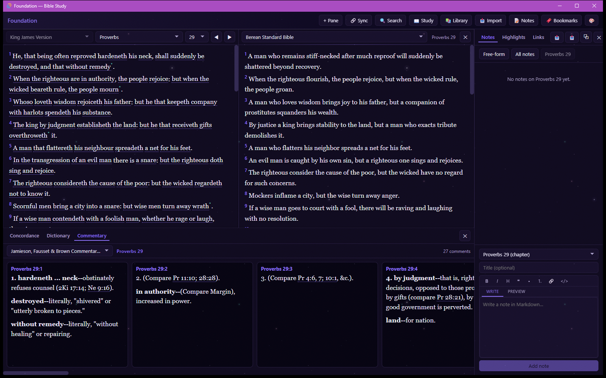
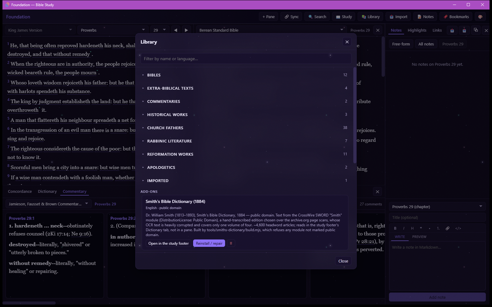

<p align="center">
  
</p>

<h1 align="center">Foundation</h1>

<p align="center">
  <b>A quiet, offline Bible study desk for one person.</b><br>
  No accounts. No ads. No tracking. No subscriptions. Just the texts.
</p>

<p align="center">
  Tauri · React · SQLite &nbsp;|&nbsp; Desktop &nbsp;|&nbsp; MIT
</p>

<p align="center"></p>

---

## Why it exists

Classic Bible software is aging, and the modern replacements tend to want an
account, a connection, or a credit card — and to sell you the next resource pack.
Foundation is the opposite: a personal study app that runs entirely on your
machine and only ships texts that are public domain or explicitly license-checked.

| The problem | What Foundation does |
|---|---|
| Study tools that need sign-in and phone home | Fully offline. Zero telemetry. The only network call is an optional download from a fixed, license-checked list. |
| Great old resources locked behind paid bundles | A built-in Library of public-domain Bibles, commentaries, and classics — free, forever. |
| Notes scattered across apps and paper | Markdown notes anchored to a verse, chapter, book, or section — shown across every translation. |
| Comparing translations means juggling windows | Up to 4 translations side by side, scroll-synced. |

## What you can do

- 📖 **Read in parallel** — up to four translations in synced columns.
- 🌐 **Grow your library** — ASV, Young's Literal, Geneva 1599, Douay-Rheims, JPS 1917 and more; Bullinger's *Companion Bible* notes, Josephus, the Church Fathers, and others install with no network at all.
- 🔤 **Go to the original words** — optional Strong's tagging for the KJV with a docked concordance.
- ✍️ **Take real notes** — Markdown, anchored to Scripture, with highlighters and cross-links between verses and sections.
- 🔍 **Search everything** — fast full-text search across translations and notes.
- 📥 **Bring your own texts** — import TXT, Markdown, JSON, CSV, XML, or EPUB.
- 🎨 **Make it yours** — six themes and a choice of reading fonts.

<p align="center"></p>

Ships with the **King James Version** and **Bible in Basic English**.

## Get started

Prerequisites: Node 20+ and Rust (stable; MSVC toolchain on Windows).

```bash
npm install
npm run tauri dev
```

## Learn more

- **[Full guide](docs/GUIDE.md)** — every feature in detail, architecture, and the data model
- **[Roadmap](ROADMAP.md)** — what's planned (and what's deliberately never planned)
- **[Themes](docs/THEMES.md)** — the visual design system

## License

Code is [MIT](LICENSE). Texts keep their own status — everything bundled or in
the Library is individually verified public domain, with one disclosed
exception (the CC BY-NC William Davidson Talmud); see `src/library.ts` for the
reasoning behind each entry. A personal, non-commercial project — contributions welcome.
